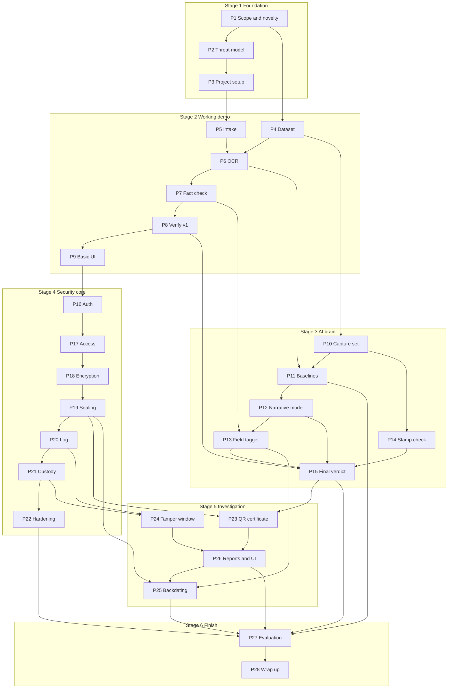

# Pramaan DMS: Master Build Plan

Version: 14 Oct 2026, updated 16 Oct 2026 to the decisions locked before Phase 2 (`DECISIONS.md` D39 to D61): English only, Tampered with Major or Minor severity, QR-sealed copies issued by Supervisors, clerks verify only, backdating built at the end, stack confirmed by the licence check (SeaweedFS, Valkey, OpenBao, PaddleOCR). Human copy lives in Claude Docs; this file is the copy Claude Code reads.

## Overview and how to use this plan

Pramaan DMS is built in **28 phases across 6 stages**, plus 1 optional stretch phase. This doc is the single build reference: every phase lists what it needs, what it produces, and how we know it is done.

**The idea in one line:** a secure evidence system for FIRs, witness statements and charge sheets that tells a harmless copy from a real edit, shows exactly what changed, and proves who had access and when.

**What done looks like:** one command (`docker compose up`) runs the full system with demo data. An officer uploads an FIR, a supervisor issues a QR-sealed copy, someone alters the printout with a pen, a phone photo of it returns **Tampered** on the public page ("A critical field was changed.") and an authenticated clerk sees the exact field highlighted, and the system shows who had access in the tamper window. Behind it sit a benchmark report with real error rates, a threat model, a research paper and a project report.

### How this doc works with the context pack

- This doc is the **human reference**: planning, tracking, presenting.
- The context pack (`CLAUDE.md`, `PHASES.md`, `LEGAL_HASH_SPEC.md`, `SECURITY_FORENSICS.md` and the rest) is what **Claude Code reads** each session.
- If the two ever disagree, fix both in the same sitting and log the change in `DECISIONS.md`.

### Phase card template

Every phase below uses the same card:

| Field | Meaning |
| --- | --- |
| Goal | What this phase achieves, in one line |
| Depends on | Phases that must be finished first |
| Inputs | Files, data or decisions it needs |
| Build tasks | The work, in order |
| Deliverables | Files, code and outputs it must produce, with paths |
| Tests | What gets tested |
| Exit criteria | The checks that close the phase |
| Owner | Workstream that leads it |
| Effort | Rough size: S (1 to 2 days), M (3 to 5 days), L (1 to 2 weeks) |
| Risk and fallback | What can go wrong and the plan B |

### Ground rules

- One phase per Claude Code session. Never start the next phase until exit criteria pass.
- Real numbers only. No guessed results, no invented citations.
- Use "tamper-evident", "designed in line with", "draft for officer review". Never "tamper-proof", "certified", "court admissible".
- Every library and model goes into the licence table. No non-commercial licences.

## Prerequisites before Phase 1

Finish this checklist before the first Claude Code session. Nothing here needs code.

### Machine

- [ ] Git installed
- [ ] Docker Desktop installed and `docker run hello-world` works
- [ ] Python 3.11 or newer
- [ ] Node 24 LTS (Node 20 reached end of life in April 2026; D69)
- [ ] Claude Code installed and signed in
- [ ] At least 16 GB RAM and 30 GB free disk (Postgres, SeaweedFS, OCR models, ClamAV signatures)

### Accounts

- [ ] Private GitHub repo `pramaan-dms` with every team member added
- [ ] Google Colab or Kaggle account for GPU training (needed from Phase 12)
- [ ] Hugging Face account (model downloads)

### Repo setup

- [ ] Context pack files copied into the repo root
- [ ] Official SIH26190 text pasted into `PROBLEM_STATEMENT.md`
- [ ] Branch rule: `main` protected, work on `phase-NN` branches, merge after exit criteria pass

### Data sources

- [ ] Blank FIR, witness statement and charge sheet formats from state police websites, in English. Blank templates only, never real filled documents
- [ ] A list of common BNS and IPC sections used in FIRs (for the dataset generator and the backdating rule)
- [ ] 3 to 4 different phones available for the real capture set (Phase 10)
- [ ] Access to a printer for the capture set and the QR demo

### Team decisions

- [ ] Final team list and workstream owners (see Team roles)
- [ ] Industry presentation date
- [ ] Final submission date
- [ ] Weekly sync time (30 minutes, review PROGRESS.md together)

## Team roles and ownership

Four workstreams, one owner each. This is a suggested split for a 4-person team; rename owners once the team is final.

| Workstream | Owner | Leads phases | Also supports |
| --- | --- | --- | --- |
| Integration and backend (lead) | Anas | 3, 5, 8, 23, 24, 28 | All phases, every merge |
| ML and Legal Hash | TBD | 4, 6, 7, 10, 11, 12, 13, 14, 15, 27 | 25 |
| Security and forensics | TBD | 2, 16, 17, 18, 19, 20, 21, 22 | 27 |
| Frontend, reports and docs | TBD | 1, 9, 25, 26 | 23, 28 |

- The owner runs the Claude Code session for that phase and checks exit criteria.
- Anyone can review. A second person reviews every phase in Stage 4 (security).
- With fewer than 4 people, merge Frontend into Integration first.

## Milestones and timeline

The build runs about 6 months, late October 2026 to April 2027, in 6 stages. Each stage ends at a gate (M1 to M6) where the whole demo is run end to end.

| Stage | Phases | Rough months | Gate |
| --- | --- | --- | --- |
| 1. Foundation | 1 to 3 | Late Oct 2026 | M1 Foundation ready |
| 2. Working demo first | 4 to 9 | Nov 2026 | M2 Working demo (most important) |
| 3. AI brain | 10 to 15 | Dec 2026 to Jan 2027 | M3 Legal Hash complete |
| 4. Security and forensics core | 16 to 22 | Feb 2027 | M4 Secure core |
| 5. Investigation and product | 23 to 26 | Mar 2027 | M5 Feature complete |
| 6. Proof and finish | 27 to 28 | Apr 2027 | M6 Submission ready |

If M2 lands by end of November, the rest of the plan has room for exams and slips. If it slips, cut UI scope in Phase 9, never the security stage.

## Dependency map

The security stage (16 to 22) depends only on the working demo (Phase 9), not on the AI stage. With 4 people, Stage 3 and Stage 4 can run **at the same time**, which can save about a month.

### Critical path

P1 → P2 → P3 → P5 → P6 → P7 → P8 → P9 → P16 → P17 → P18 → P19 → P20 → P21 → P24 → P26 → P27 → P28. Any delay on these 18 phases delays the whole project.

### What can run in parallel

| While this runs | This can run too | Who |
| --- | --- | --- |
| P3 Project setup | P4 Dataset generator | Integration / ML |
| P5 Intake | P4 Dataset (finishing) | Integration / ML |
| P8 Verify v1, P9 UI | P10 Capture set photos | Integration, Frontend / whole team |
| Stage 3 (P11 to P15) | Stage 4 (P16 to P22) | ML / Security |
| P23 QR, P24 Tamper window | P26 Reports (P25 Backdating runs last, after P26) | Integration / Frontend |
| P27 Evaluation | Paper and report drafting | ML / everyone |

## Stage 1: Foundation (Phases 1 to 3)

Stage 1 locks what we build and sets up the repo. Output is docs plus a running skeleton. Gate: **M1 Foundation ready**.

### Phase 1: Scope, tampering definition, literature, novelty

**Goal:** lock exactly what counts as tampering and prove the research gap.

**Depends on:** prerequisites checklist.

**Inputs:** SIH26190 official text, context pack, blank FIR formats.

**Build tasks**

1. Check our reading of SIH26190 against the official text. Flag any mismatch.
2. Write scope: users and roles, document types, languages, in and out of scope.
3. Write the tampering definition: Identical, Equivalent, Tampered (Major or Minor), Inconclusive. Add 20+ worked examples, including "reworded statement = Tampered" and number-format traps.
4. Finalize the critical field list with a type for each field (date, number, name, section, text).
5. Literature review: 30+ real papers and systems across secure DMS, chain of custody, fuzzy hashing (ssdeep, TLSH), perceptual hashing, semantic hashing, contrastive learning, Indic OCR, document tamper detection, transparency logs, legal NLP, and existing Indian systems.
6. Write the gap table and novelty statement with 2 to 3 research questions.

**Deliverables**

- `docs/SCOPE.md`
- `docs/TAMPERING_DEFINITION.md`
- `docs/CRITICAL_FIELDS.md`
- `docs/LITERATURE.md` (with gap table)
- `docs/NOVELTY.md`

**Tests:** a team member spot-checks 10 citations by finding each paper online.

**Exit criteria**

- [ ] All five docs written and committed
- [ ] Every citation real; unsure ones marked `TODO: verify`
- [ ] Research gap stated in 3 sentences or fewer
- [ ] Critical field list agreed by the team

**Owner:** Frontend, reports and docs · **Effort:** M

**Risk and fallback:** made-up citations from AI tools. Fallback: only keep papers someone has opened; use Google Scholar to confirm each one.

### Phase 2: Threat model, requirements, licences

**Goal:** know every way the system can be attacked and every rule it must follow, before writing code.

**Depends on:** Phase 1.

**Inputs:** `SECURITY_FORENSICS.md`, scope and tampering docs.

**Build tasks**

1. STRIDE threat table for each component (API, storage, DB, log, worker, verify page, model).
2. Add the three special groups: insider threats, attacks on the AI, verification abuse. Map each threat to the phase that mitigates it.
3. Requirements: functional (per role), non-functional (verify latency target per page, uptime for demo, max file size), legal context (IT Act 2000, BSA 2023 Section 63, DPDP Act 2023, BNS effective date). Mark every legal claim to verify.
4. Licence table for every planned library and model. Reject any non-commercial licence.
5. OWASP ASVS Level 2 checklist with each item marked planned, not applicable, or done.

**Deliverables**

- `docs/THREAT_MODEL.md`
- `docs/REQUIREMENTS.md`
- `docs/LICENCES.md`
- `docs/ASVS_CHECKLIST.md`

**Tests:** every requirement has a matching test idea; every threat has a mitigation and a phase number.

**Exit criteria**

- [ ] STRIDE table covers all components plus the 3 special groups
- [ ] Every threat mapped to a phase
- [ ] Every requirement testable
- [ ] No licence blockers

**Owner:** Security and forensics · **Effort:** M

**Risk and fallback:** threat model becomes a huge document nobody uses. Fallback: keep one table, one row per threat, max 60 rows.

### Phase 3: Project setup

**Goal:** a repo where `docker compose up` starts every service and CI checks security from day one.

**Depends on:** Phase 2 (stack and licences confirmed).

**Inputs:** `ARCHITECTURE.md`, licence table.

**Build tasks**

1. Create the repo layout from `ARCHITECTURE.md` (app modules, ml folders, frontend, docs).
2. Docker Compose with frontend, api, worker, postgres, seaweedfs, valkey, openbao (dev), clamav (D57, D58, D60). Health checks on all.
3. FastAPI skeleton: settings from env, structured JSON logging, `/health` endpoint.
4. Alembic set up with an empty first migration.
5. React + TypeScript + Vite skeleton with a placeholder page.
6. GitHub Actions: pytest, Bandit, Semgrep, pip-audit, npm audit, gitleaks.
7. `.env.example`, `README.md` with run steps, `Makefile` or scripts for common commands.

**Deliverables**

- Running skeleton in the repo
- `docker-compose.yml`, `.env.example`, `README.md`
- `.github/workflows/ci.yml`

**Tests:** health check test, CI green on first push.

**Exit criteria**

- [ ] `docker compose up` brings all 8 containers to healthy
- [ ] `/health` returns OK
- [ ] CI passes with all security scanners running
- [ ] A fresh clone runs by following README alone

**Owner:** Integration and backend · **Effort:** S to M

**Risk and fallback:** ClamAV or OpenBao eat too much RAM on student laptops. Fallback: Compose profiles so heavy services start only when needed.

## Stage 2: Working demo first (Phases 4 to 9)

Stage 2 builds a thin but complete slice: upload, seal, OCR, field check, verify, show the change. Gate: **M2 Working demo**, the most important milestone in the plan.

### Phase 4: FIR-Tamper dataset v1

**Goal:** a reproducible dataset of legal documents with labelled tampering, to build and test everything that follows.

**Depends on:** Phase 1 (tampering definition, critical fields).

**Inputs:** blank FIR, statement and charge sheet formats; critical field list; BNS and IPC section list.

**Build tasks**

1. Field value generators: Indian names (in English), places, police stations, dates, amounts, vehicle and phone numbers, BNS and IPC sections.
2. Templates for FIR, witness statement, charge sheet in English with realistic layout.
3. Render each document to PDF and to page images.
4. Tamper generator: field edits (date, name, amount, section), narrative edits (word swap, negation, sentence added or removed), visual edits (stamp removed or swapped).
5. Equivalence traps: number formats, date formats, standard separators, honorifics, reflowed layout, different fonts.
6. Labels per pair: verdict, severity, list of changes with page and box.
7. Fixed train, validation and test split by document (no leakage). Record a SHA-256 for each split.

**Deliverables**

- `ml/data/generator/` (code)
- `data/fir_tamper_v1/` (generated data, git-ignored, rebuilt from seed)
- `docs/DATASET.md` (schema, counts, split hashes, how to regenerate)

**Tests:** generator is deterministic from a seed; label checker confirms every label matches its pair on a random sample of 50.

**Exit criteria**

- [ ] Same seed gives byte-identical dataset
- [ ] At least 1,000 originals and 5,000 labelled pairs (adjust after first run)
- [ ] Every tamper type and trap type present in every split
- [ ] Split hashes recorded in `DATASET.md`

**Owner:** ML and Legal Hash · **Effort:** M to L

**Risk and fallback:** synthetic layouts look too uniform. Fallback: add more layout variants and fonts, and rely on the real capture set (Phase 10) for testing.

### Phase 5: Evidence intake (basic)

**Goal:** documents enter the system with a hash at intake and can never be overwritten.

**Depends on:** Phase 3.

**Inputs:** `ARCHITECTURE.md` core tables.

**Build tasks**

1. DB schema v1: cases, documents, document\_versions, storage\_objects, fingerprints, verdicts, custody\_events.
2. Upload API: magic byte type check (PDF, PNG, JPEG, TIFF), size limit, SHA-256 at intake.
3. Store originals in SeaweedFS with S3 Object Lock (compliance mode) and versioning.
4. Custody event written on every upload.
5. Document list and detail API.

**Deliverables**

- `app/evidence/`, `app/cases/`, migrations
- API endpoints for upload, list, detail

**Tests:** wrong file type rejected; oversized file rejected; overwrite attempt on an object fails; SHA-256 matches a local calculation.

**Exit criteria**

- [ ] Upload works end to end and stores SHA-256
- [ ] Overwrite and delete of an original fail at the storage level
- [ ] Custody event recorded for each upload
- [ ] Tests pass in CI

**Owner:** Integration and backend · **Effort:** M

**Risk and fallback:** SeaweedFS object lock setup is fiddly. Fallback: enable versioning plus a bucket policy that denies delete, document the gap, fix in Phase 21.

### Phase 6: OCR pipeline

**Goal:** reliable text, word boxes and confidence scores from any input, in the background.

**Depends on:** Phase 4 (sample data), Phase 5 (documents to process).

**Inputs:** dataset sample with ground-truth text.

**Build tasks**

1. Preprocessing: deskew, perspective correction for photos, denoise, contrast, page split.
2. Benchmark PaddleOCR and Tesseract on 100 English pages (clean and noisy): character error rate, word error rate, speed, how useful the confidence scores are.
3. Pick the engine; record numbers and reason in `DECISIONS.md`.
4. OCR job in the worker: output per page = text, word boxes, per-word confidence. Store as JSON.
5. Record OCR engine name and version with every output.

**Deliverables**

- `app/legalhash/preprocess.py`, `app/legalhash/ocr.py`
- `docs/OCR_BENCHMARK.md`

**Tests:** preprocessing on rotated and skewed samples; OCR output schema test; same input gives same output.

**Exit criteria**

- [ ] Engine chosen with real numbers in `OCR_BENCHMARK.md`
- [ ] OCR runs in the worker and stores text, boxes, confidence
- [ ] Phone photo samples produce usable text after preprocessing

**Owner:** ML and Legal Hash · **Effort:** M

**Risk and fallback:** OCR quality is poor on phone photos. Fallback: better preprocessing, lower expectations for photos, report per-capture results honestly.

### Phase 7: Fact check (field fingerprint)

**Goal:** extract critical fields, normalize them, and fingerprint each one so a one-digit change is always caught.

**Depends on:** Phase 6.

**Inputs:** critical field list, `LEGAL_HASH_SPEC.md` sections 4 to 6.

**Build tasks**

1. Rule and regex field extraction using OCR text, boxes and printed labels ("FIR No.", "Date", "Police Station").
2. Normalization module: digits, Indian number formats, dates to ISO, section references, names (NFC, whitespace), zero-width removal, homoglyph flagging.
3. HMAC-SHA-256 per field and per narrative entity (key from config now, OpenBao in Phase 18).
4. Store field map with page and box for each field.
5. Measure field extraction accuracy on the test split.

**Deliverables**

- `app/legalhash/fields.py`, `app/legalhash/normalize.py`, `app/legalhash/fingerprint.py`
- Unit tests for every normalization rule

**Tests:** every equivalence trap gives zero changes; one-digit edits in dates and amounts are caught; homoglyph swap is flagged.

**Exit criteria**

- [ ] Field extraction accuracy measured and recorded
- [ ] 100% of equivalence traps pass
- [ ] 100% of single-digit field edits caught on clean inputs

**Owner:** ML and Legal Hash · **Effort:** M

**Risk and fallback:** layouts vary too much for rules. Fallback: limit v1 to our own templates; the MuRIL tagger in Phase 13 handles variety.

### Phase 8: Verify v1

**Goal:** compare a candidate file to a stored document and return one of the four verdicts with the changes.

**Depends on:** Phase 7.

**Inputs:** fingerprints from Phase 7, OCR confidence from Phase 6.

**Build tasks**

1. Verify API: candidate upload plus target document ID.
2. Identical check by SHA-256.
3. Run OCR and field fingerprint on the candidate.
4. Tampered if any clear change exists (unreadable fields listed as "could not verify"); Inconclusive only if there is no clear change and a critical field is below the threshold; redacted copies rejected with a message.
5. Field diff: changed, missing, extra fields with page and box.
6. Equivalent if no changes and nothing unreadable, else Tampered with severity (Major or Minor).
7. Verdict record stores verdict, changes, confidences, thresholds, OCR version, rules version, git commit.
8. Re-run endpoint to prove repeatability.

**Deliverables**

- `app/verify/`
- Verdict schema and API docs

**Tests:** each verdict type reached on crafted samples; re-run of a stored verdict gives the same result.

**Exit criteria**

- [ ] All 4 verdicts work on dataset samples
- [ ] Every Tampered verdict lists the exact field and location
- [ ] Re-run matches the stored verdict

**Owner:** Integration and backend · **Effort:** M

**Risk and fallback:** too many Inconclusive results on photos. Fallback: tune the confidence threshold on validation data and log the trade-off.

### Phase 9: Basic UI (working demo milestone)

**Goal:** the full flow works in a browser.

**Depends on:** Phase 8.

**Inputs:** API from Phases 5 and 8.

**Build tasks**

1. Placeholder login (replaced in Phase 16).
2. Case list, upload page, document list, document detail with page preview.
3. Verify page: upload or photograph a candidate, see the verdict.
4. Change view: changed fields highlighted on the page image, with old and new values where the user is allowed to see them.
5. Phone-friendly layout for the verify page.

**Deliverables**

- `frontend/` pages and components
- Short screen recording of the demo flow

**Tests:** component tests for the verdict view; manual run of the demo script.

**Exit criteria**

- [ ] Upload, then verify a phone photo, then see the verdict and highlighted change, all in the browser
- [ ] Works on a phone screen
- [ ] Demo recording saved

**Owner:** Frontend, reports and docs · **Effort:** M

**Risk and fallback:** UI work grows. Fallback: plain, functional screens now; polish is Phase 26.

## Stage 3: The AI brain (Phases 10 to 15)

Stage 3 adds the learned narrative hash, smarter field extraction and the stamp check, then combines them into the final Legal Hash. Gate: **M3 Legal Hash complete**.

### Phase 10: Real capture set and augmentation

**Goal:** real-world photos and scans so results are not only from clean synthetic data.

**Depends on:** Phase 4.

**Inputs:** 100 to 200 dataset documents, printer, 3 to 4 phones.

**Build tasks**

1. Print the selected originals and some tampered versions (including pen edits made by hand on paper).
2. Photograph each on different phones: daylight, tube light, low light, angled, folded, crumpled. Also flatbed scans.
3. Capture tool: match each photo to its source document ID and record phone, light and angle.
4. Augmentation pipeline: blur, noise, JPEG compression, perspective, shadow, fold lines, fake stamps.
5. Version both sets with hashes.

**Deliverables**

- `ml/data/capture/` (matching tool)
- `ml/data/augment/` (pipeline)
- `data/capture_v1/` with a manifest CSV
- Update `docs/DATASET.md`

**Tests:** every capture matched to a source; augmentation output looks realistic on a visual spot check of 30 images.

**Exit criteria**

- [ ] At least 400 real captures labelled with condition tags
- [ ] Augmentation runs on the full dataset reproducibly
- [ ] Capture set used only for test and validation, never training (record this)

**Owner:** ML and Legal Hash (whole team helps with photos) · **Effort:** M

**Risk and fallback:** capture takes longer than planned. Fallback: start with 200 captures, add more by Phase 27.

### Phase 11: Baselines

**Goal:** measure how existing methods do on our test set, so our results have something to beat.

**Depends on:** Phases 4, 6, 10.

**Inputs:** test split, capture set, OCR output.

**Build tasks**

1. Shared metrics script: Tampered recall (Major and Minor), false alarm rate on Equivalent, Inconclusive rate, latency, per capture condition.
2. Run SHA-256, ssdeep, TLSH, pHash (whole page), OCR text diff, plain embedding cosine (MuRIL mean-pooled) with thresholds tuned on validation.
3. Write the baseline results table.

**Deliverables**

- `ml/eval/metrics.py`, `ml/eval/baselines/`
- `docs/RESULTS.md` (baseline section)

**Tests:** metrics script unit tests on a toy set with known answers.

**Exit criteria**

- [ ] All 6 baselines run on the same test set
- [ ] Results table from real runs, with the run command recorded

**Owner:** ML and Legal Hash · **Effort:** S to M

**Risk and fallback:** ssdeep or TLSH Python bindings fail to install. Fallback: run them in a small separate container; drop one only if both bindings fail, and note it.

### Phase 12: Narrative hash model

**Goal:** a learned binary hash that ignores OCR and capture noise but reacts to real wording changes.

**Depends on:** Phases 4, 6, 10, 11.

**Inputs:** narrative texts from the dataset; OCR outputs of augmented and captured copies (positives); edited narratives (negatives).

**Build tasks**

1. Build triplets: anchor = clean narrative chunk; positive = same chunk after OCR of a noisy copy; negative = same chunk with a real edit. Include hard negatives (one word swapped, negation added, number in text changed).
2. Model: MuRIL base encoder, projection to 256 dimensions, tanh hash layer, sign at inference.
3. Loss: triplet loss plus quantization loss.
4. Train on Colab or Kaggle GPU. Save config, seed, dataset hash, training curves.
5. Chunk alignment and Hamming comparison; choose threshold on validation.
6. Compare against IndicBERT or LaBSE as an alternative encoder if time allows.

**Deliverables**

- `ml/train/narrative_hash/` (code, configs)
- Model file plus its SHA-256
- `docs/MODEL_CARD.md` (data, training, metrics, limits)

**Tests:** inference gives the same bits for the same input; a hand-made set of 50 edits and 50 noisy copies scores as expected.

**Exit criteria**

- [ ] Validation results: narrative edit recall and false alarm rate recorded
- [ ] Beats plain embedding cosine baseline on validation
- [ ] Model card written

**Owner:** ML and Legal Hash · **Effort:** L

**Risk and fallback:** model does not separate noise from edits well. Fallback: increase hard negatives, try sentence-level instead of window chunks; worst case the F part still catches all critical changes and N is reported honestly as partial.

### Phase 13: Smarter field extraction

**Goal:** extract fields from layouts the rules cannot handle.

**Depends on:** Phases 7 and 12 (shares the MuRIL base).

**Inputs:** field labels from the dataset generator.

**Build tasks**

1. Token classification model on MuRIL (BIO tags per field type).
2. Train on synthetic data; test on the capture set.
3. Combine: rules first, tagger fills gaps, conflicts flagged as low confidence.

**Deliverables**

- `ml/train/field_tagger/`
- Updated `app/legalhash/fields.py`

**Tests:** extraction accuracy on test split, before and after.

**Exit criteria**

- [ ] Field accuracy improves over Phase 7 on the test split (both numbers recorded)
- [ ] Conflicts between rules and tagger produce low confidence, not silent picks

**Owner:** ML and Legal Hash · **Effort:** M

**Risk and fallback:** no real gain. Fallback: keep rules only, document the experiment as a negative result.

### Phase 14: Stamp and signature check

**Goal:** catch swapped or removed stamps and signatures, which OCR cannot see.

**Depends on:** Phases 4 and 10.

**Inputs:** documents with stamps and signatures, visual tamper samples.

**Build tasks**

1. Region detection: colour and shape heuristics for stamps (round, blue or violet ink), position rules for signatures. Optional small detector.
2. Page alignment to the original using feature matching.
3. Perceptual hash (pHash or dHash) per region; threshold on validation.

**Deliverables**

- `app/legalhash/visual.py`

**Tests:** stamp removal, stamp swap, signature swap caught; Equivalent captures not flagged.

**Exit criteria**

- [ ] Catch rate and false alarm rate measured on validation
- [ ] Region location shown in the change list

**Owner:** ML and Legal Hash · **Effort:** M

**Risk and fallback:** too many false alarms on photos. Fallback: report visual changes as a warning on Equivalent instead of a Tampered verdict, and say so in limitations.

### Phase 15: Final verdict logic and model integrity

**Goal:** one Legal Hash that combines F, N and V, with locked thresholds and a model nobody can swap.

**Depends on:** Phases 8, 12, 13, 14.

**Inputs:** all three parts, validation set.

**Build tasks**

1. Combined verdict logic from `LEGAL_HASH_SPEC.md` section 9.
2. Tune all thresholds together on validation; never touch test.
3. Ablation on validation: F only, N only, F+N, F+N+V.
4. Signed model registry: model hash plus signature; service refuses an unknown model.
5. Thresholds and rules version in a signed config file.
6. Fingerprint record v2 with all parts, signed.

**Deliverables**

- `app/legalhash/verdict.py`, `ml/registry/`
- `docs/RESULTS.md` (validation ablation section)

**Tests:** model swap test (replace file, service refuses); config tamper test; full pipeline regression tests.

**Exit criteria**

- [ ] Full Legal Hash runs end to end through the existing UI
- [ ] Ablation table recorded
- [ ] Swapped model and edited config both blocked

**Owner:** ML and Legal Hash · **Effort:** M

**Risk and fallback:** combined pipeline is slow on CPU. Fallback: run N only on pages where F shows no change, cache OCR, report latency honestly.

## Stage 4: Security and forensics core (Phases 16 to 22)

Stage 4 turns the demo into a secure evidence system: real login, insider controls, encryption, sealing, a tamper-evident log and chain of custody. A second person reviews every phase here. Gate: **M4 Secure core**.

### Phase 16: Authentication

**Goal:** only real, verified users get in.

**Depends on:** Phase 9 (replaces placeholder login).

**Inputs:** threat model, ASVS checklist.

**Build tasks**

1. User model; Argon2id password hashing (`argon2-cffi`).
2. Password rules (length, breached-password check optional).
3. TOTP MFA (`pyotp`) with enrolment QR and backup codes.
4. Lockout after repeated failures, with time-based unlock.
5. Secure sessions: HttpOnly, Secure, SameSite cookies; idle and absolute timeouts; logout everywhere.
6. Every login, failure, MFA event and lockout logged as a custody-style event.

**Deliverables**

- `app/auth/`, login and MFA screens

**Tests:** wrong password, wrong TOTP, lockout and unlock, session expiry, replayed TOTP rejected.

**Exit criteria**

- [ ] MFA required for all staff roles
- [ ] Lockout works and is logged
- [ ] Auth items in ASVS checklist marked done

**Owner:** Security and forensics · **Effort:** M

**Risk and fallback:** MFA slows down demos. Fallback: demo accounts with pre-enrolled TOTP in an authenticator app; never disable MFA.

### Phase 17: Access control and insider controls

**Goal:** people see only their own cases, and no single insider can quietly tamper.

**Depends on:** Phase 16.

**Inputs:** roles from `PROJECT_BRIEF.md`.

**Build tasks**

1. Roles: Investigating Officer, Supervisor, Court Clerk, Auditor, System Admin.
2. Case-level membership checked on every endpoint (deny by default).
3. Admin cannot read evidence content or download originals.
4. Auditor reads logs and custody, never content.
5. Two-person approval workflow: request, second approver, expiry. Used for key access or rotation, legal hold release, role grants, bulk export, archive.
6. Access matrix document and a test for every cell.

**Deliverables**

- `app/access/`, `docs/ACCESS_MATRIX.md`

**Tests:** IDOR test for every resource (change an ID, get denied); admin content access denied and logged; one person cannot approve their own request.

**Exit criteria**

- [ ] Every access matrix cell has a passing test
- [ ] Admin evidence access blocked and logged
- [ ] Two-person rule enforced on all listed actions

**Owner:** Security and forensics · **Effort:** M to L

**Risk and fallback:** permission checks missed on some endpoint. Fallback: a single dependency that every router must use, plus a test that lists all routes and fails if any route lacks it.

### Phase 18: Encryption and keys

**Goal:** stored files are useless to anyone who steals the storage.

**Depends on:** Phase 17.

**Inputs:** `SECURITY_FORENSICS.md` Part D.

**Build tasks**

1. OpenBao integration (dev mode for the demo, documented path to production).
2. Key hierarchy: master key in OpenBao, key encryption keys, per-document data keys (envelope encryption).
3. AES-256-GCM encryption of every original before it reaches SeaweedFS.
4. Move HMAC field key and Ed25519 signing key into OpenBao.
5. KEK rotation with re-wrap of data keys; old keys kept for decrypt and verify only.
6. Every key use logged.
7. Migration that encrypts documents uploaded before this phase.

**Deliverables**

- `app/crypto/`, `docs/KEY_MANAGEMENT.md`

**Tests:** raw stored object is not readable; decrypt round trip; rotation leaves all files readable; tampered ciphertext fails authentication.

**Exit criteria**

- [ ] All originals encrypted at rest (checked by reading raw objects)
- [ ] Rotation tested with no data loss
- [ ] No keys in code or env files except the OpenBao bootstrap

**Owner:** Security and forensics · **Effort:** M

**Risk and fallback:** OpenBao adds setup pain. Fallback: a local key service module with the same interface; switch back to OpenBao before Phase 27.

### Phase 19: Sealing

**Goal:** prove what was received and when, in a way anyone can check later.

**Depends on:** Phase 18.

**Inputs:** intake and fingerprint records.

**Build tasks**

1. Ed25519 signature on every intake record (doc ID, SHA-256, size, uploader, time).
2. Ed25519 signature on every fingerprint record.
3. RFC 3161 timestamp request at intake from a public TSA (for example FreeTSA); store the token.
4. Verify functions for signatures and timestamp tokens.
5. Fallback queue if the TSA is offline: retry and mark the record "timestamp pending".

**Deliverables**

- `app/seal/`

**Tests:** valid seal verifies; one changed byte fails; timestamp token verifies against the TSA certificate.

**Exit criteria**

- [ ] Every new document has a signed intake record and a timestamp token
- [ ] Tampered seal detected in tests

**Owner:** Security and forensics · **Effort:** S to M

**Risk and fallback:** public TSA unreachable on college network. Fallback: run a local TSA for the demo, clearly labelled as local.

### Phase 20: Transparency log

**Goal:** an action log that nobody, including the admin, can rewrite without being caught.

**Depends on:** Phase 19.

**Inputs:** `SECURITY_FORENSICS.md` Part E.

**Build tasks**

1. Append-only Merkle tree (RFC 6962 style) over log entries.
2. Each entry signed: event type, actor, document, time, previous tree size.
3. Signed tree head after each batch.
4. Inclusion proof and consistency proof APIs.
5. Daily export of the signed tree head to an outside location (a public git repo or a file the auditor keeps).
6. Background checker that verifies consistency and raises an alert on mismatch.
7. Route all custody events through the log.

**Deliverables**

- `app/ledger/`, `docs/TRANSPARENCY_LOG.md`

**Tests:** edit a log row directly in Postgres, checker flags it; delete a row, checker flags it; proofs verify with an independent script.

**Exit criteria**

- [ ] Direct DB edits and deletes detected
- [ ] Proofs verify with a standalone verifier script
- [ ] Daily tree head export runs

**Owner:** Security and forensics · **Effort:** M to L

**Risk and fallback:** proof code is tricky. Fallback: start with a hash chain plus signed heads (simpler), then upgrade to the Merkle tree within the phase.

### Phase 21: Chain of custody, legal hold, archive

**Goal:** a complete, readable history of every document, and no way to destroy evidence.

**Depends on:** Phase 20.

**Inputs:** log events.

**Build tasks**

1. Custody timeline view per document: who, what, when, from where, why (reason field for sensitive actions).
2. Legal hold: blocks archive; release needs two-person approval.
3. Archive instead of delete everywhere; archived items stay verifiable.
4. Search custody by user, document, date range.

**Deliverables**

- `app/custody/`, custody timeline screen

**Tests:** no delete endpoint exists (route list test); legal hold blocks archive; release without second approver fails.

**Exit criteria**

- [ ] Custody view complete for every action type
- [ ] Evidence cannot be deleted through any route
- [ ] Legal hold enforced and tested

**Owner:** Security and forensics · **Effort:** S to M

**Risk and fallback:** low risk. Main danger is a forgotten delete path in admin tools; the route list test catches it.

### Phase 22: App hardening

**Goal:** close the common web attack paths.

**Depends on:** Phases 16 to 21.

**Inputs:** ASVS checklist, OWASP Top 10.

**Build tasks**

1. TLS in Docker Compose (self-signed for local, documented for real certs).
2. Security headers: CSP, HSTS, X-Content-Type-Options, frame protection.
3. CSRF protection, rate limiting on login, upload and public verify.
4. ClamAV scan with quarantine before intake.
5. Input validation everywhere, safe error messages, no stack traces to users.
6. Log scrubbing: no passwords, tokens or document content in logs.
7. Upload safety: zip bomb and decompression limits, page count limits.

**Deliverables**

- Updated `docs/ASVS_CHECKLIST.md`

**Tests:** header tests; rate limit tests; EICAR test file quarantined; malformed PDF rejected cleanly.

**Exit criteria**

- [ ] ASVS Level 2 items for this scope marked done or justified
- [ ] EICAR quarantined
- [ ] Security scanners in CI clean or findings documented

**Owner:** Security and forensics · **Effort:** M

**Risk and fallback:** CSP breaks the frontend. Fallback: start in report-only mode, fix violations, then enforce.

## Stage 5: Investigation and product (Phases 23 to 26)

Stage 5 adds the features that win the industry demo: QR-sealed copies, tamper window, forensic reports and, last, backdating checks. Gate: **M5 Feature complete**.

### Phase 23: QR-sealed copy

**Goal:** anyone can verify a paper copy with a phone, without the original file.

**Depends on:** Phases 15 and 19.

**Inputs:** signed fingerprint records, `LEGAL_HASH_SPEC.md` section 10.

**Build tasks**

1. Issue QR-sealed copy: PDF of the document with a QR (doc ID, version, short record hash, signature) and a human-readable copy ID.
2. Every issue logged and limited to the Supervisor role (IOs can request one).
3. Public verify page (no login): scan QR or upload a photo, check the signature, fetch the fingerprint record, run the Legal Hash, show one fixed message per outcome (for example "A critical field was changed.").
4. Never show document content, field names, values or locations to public users. Authenticated staff with case access see the full change list.
5. Rate limit and log every public verify.

**Deliverables**

- `app/verify/qr.py`, public verify page

**Tests:** forged QR rejected; QR copied onto a different document gives Tampered; valid copy gives Equivalent; no field name, value or location in any public response.

**Exit criteria**

- [ ] Print, pen edit, phone photo: public page says "A critical field was changed."; an authenticated clerk sees the correct field
- [ ] Forged and replayed QR both handled correctly
- [ ] Works end to end on a real phone

**Owner:** Integration and backend · **Effort:** M

**Risk and fallback:** QR too dense to scan. Fallback: QR holds only doc ID, version and signature; the full record is fetched online.

### Phase 24: Tamper window

**Goal:** when a change is found, show when it happened and who had access then.

**Depends on:** Phases 20 and 21.

**Inputs:** custody log, verdict history.

**Build tasks**

1. Checkpoints: every verify, export and QR-sealed copy issue records a fingerprint check result.
2. Window finder: last checkpoint where the document was Equivalent, first where it was Tampered.
3. List every custody event and user between the two.
4. Window view on the document page, with log proofs linked.

**Deliverables**

- `app/investigate/tamper_window.py`, window screen

**Tests:** scripted scenario with 3 users and 2 copies gives the correct window and user list.

**Exit criteria**

- [ ] Demo scenario shows the correct window and users
- [ ] Every event in the window has a verifiable log proof

**Owner:** Integration and backend · **Effort:** S to M

**Risk and fallback:** few checkpoints make wide windows. Fallback: periodic background re-checks of stored copies add checkpoints.

### Phase 25: Backdating checks (built last, after Phase 26)

**Goal:** flag documents whose dates do not make sense.

**Depends on:** Phases 13 and 19.

**Inputs:** extracted fields, timestamp tokens, BNS effective date verified in Phase 2.

**Build tasks**

1. Law anachronism rule: document dated before 1 July 2024 citing BNS, BNSS or BSA sections is flagged; related reverse checks agreed in Phase 2.
2. Timeline sanity: report date before incident date, statement dated before its FIR, charge sheet before FIR, and similar.
3. Timestamp evidence: claimed document date compared with the RFC 3161 sealing time.
4. Every flag explained in one plain sentence with the fields involved.

**Deliverables**

- `app/investigate/backdating.py`, flags on the document page

**Tests:** crafted positive and negative cases for every rule; false flag rate on clean dataset samples.

**Exit criteria**

- [ ] Every rule has passing positive and negative tests
- [ ] False flag rate on clean samples measured and recorded

**Owner:** Frontend, reports and docs (with ML) · **Effort:** S to M

**Risk and fallback:** low risk. Main care point: the legal date must be verified from an official source, not memory.

### Phase 26: Reports and UI polish

**Goal:** outputs a police officer or court clerk could actually use, and a UI that demos well.

**Depends on:** Phases 23, 24, 25.

**Inputs:** all verdict, custody and seal data.

**Build tasks**

1. Forensic PDF report: verdict, changes, custody history, hashes, timestamps, tool and model versions, known error rates. Signed.
2. Section 63 draft certificate: auto-filled with hash values and record details, clearly marked "Draft for officer review".
3. Role dashboards: IO (my cases), Supervisor (approvals, flags, issue QR-sealed copies), Clerk (verify only), Auditor (log and proofs), Admin (users, health).
4. UI polish: consistent design, phone layout, empty and error states, loading states for background jobs.

**Deliverables**

- `app/reports/`, report templates, dashboards

**Tests:** report signature verifies; report content matches the database; each role completes its main task in a scripted UI test.

**Exit criteria**

- [ ] Forensic report and Section 63 draft generate and verify
- [ ] Every role completes its main task in the UI
- [ ] Demo flow looks clean on laptop and phone

**Owner:** Frontend, reports and docs · **Effort:** M to L

**Risk and fallback:** polish eats the schedule. Fallback: polish only screens in the demo script.

## Stage 6: Proof and finish (Phases 27 to 28)

Stage 6 proves everything with real numbers and live attacks, then packages it for the panel, the paper and the report. Gate: **M6 Submission ready**.

### Phase 27: Evaluation and security testing

**Goal:** final, honest numbers and a live attack demo.

**Depends on:** Phases 11, 15, 22, 26.

**Inputs:** locked test split, capture set, baselines, final system.

**Build tasks**

1. Freeze code, model and thresholds. Record the git commit.
2. Run the final Legal Hash on the test split and capture set: every metric, per tamper type and per capture condition, plus latency.
3. Run all baselines again on the same commit.
4. Ablation on test: F, N, F+N, F+N+V.
5. Adversarial tests: homoglyphs, zero-width characters, single-pixel digit edits, screen re-photo, QR replay.
6. Attack demo script: direct DB edit, stored file swap, admin opens evidence, model swap, forged QR. Each must be caught and shown.
7. OWASP ZAP scan; fix findings; finalize ASVS checklist.
8. Write the known error rates in plain language.

**Deliverables**

- `docs/RESULTS.md` (final), `docs/ATTACK_DEMO.md`, ZAP report, final `docs/ASVS_CHECKLIST.md`

**Tests:** results reproducible from the recorded commit with one command.

**Exit criteria**

- [ ] Every table filled from real runs, with the command that made it
- [ ] Attack demo runs end to end and every attack is caught
- [ ] ZAP high findings fixed

**Owner:** ML and Legal Hash, with Security and forensics · **Effort:** L

**Risk and fallback:** results weaker than hoped. Fallback: report them honestly with analysis of where and why; a clear negative result with error analysis still makes a valid paper.

### Phase 28: Wrap up

**Goal:** everything handed in, presented and reproducible from scratch.

**Depends on:** Phase 27.

**Inputs:** all docs and results.

**Build tasks**

1. Research paper draft in the target conference format.
2. Project report in the college format.
3. OpenAPI docs exported; user guide per role; `docs/LIMITATIONS.md`.
4. Seeded demo data and the 5-minute demo script.
5. Backup and restore test (Postgres, SeaweedFS, OpenBao).
6. Clean install on a fresh machine following README only.
7. Industry pitch deck and a 2-minute backup demo video.

**Deliverables**

- Paper draft, project report, pitch deck, demo video
- `docs/USER_GUIDE.md`, `docs/LIMITATIONS.md`, `docs/DEMO_SCRIPT.md`

**Tests:** fresh-machine install; restore drill.

**Exit criteria**

- [ ] Fresh machine runs the full demo in one command
- [ ] Restore from backup works
- [ ] Paper, report, deck and video complete

**Owner:** Integration and backend (all hands) · **Effort:** L

**Risk and fallback:** writing left too late. Fallback: paper and report sections are drafted continuously from Phase 1 docs and `RESULTS.md`, so Phase 28 only edits and assembles.

### Phase S (stretch): Contradiction check

**Goal:** flag contradictions between statements in the same case (for example two witnesses disagreeing on the time).

**Depends on:** Phase 27 done with time left. Never blocks anything above.

**Build tasks:** pick a multilingual NLI model with a commercial-friendly licence; extract claims (time, place, people) per statement; run pairwise NLI; show flags with both sentences.

**Exit criteria**

- [ ] Time-boxed to 1 week
- [ ] Accuracy measured on a small hand-made set, or the experiment documented as future work

## Master deliverables register

Every deliverable, where it comes from, where it lives and who uses it. Tick the Done column as each lands.

### Documents

| Deliverable | Phase | Location | Used by | Done |
| --- | --- | --- | --- | --- |
| Scope | 1 | `docs/SCOPE.md` | Report, paper |  |
| Tampering definition | 1 | `docs/TAMPERING_DEFINITION.md` | Phases 4, 7, 8; paper |  |
| Critical fields list | 1 | `docs/CRITICAL_FIELDS.md` | Phases 4, 7, 13 |  |
| Literature review and gap table | 1 | `docs/LITERATURE.md` | Paper, report |  |
| Novelty and research questions | 1 | `docs/NOVELTY.md` | Paper, pitch |  |
| Threat model (STRIDE + insider + AI) | 2 | `docs/THREAT_MODEL.md` | Stage 4, panel |  |
| Requirements | 2 | `docs/REQUIREMENTS.md` | All phases, report |  |
| Licence table | 2, updated always | `docs/LICENCES.md` | Industry panel |  |
| ASVS Level 2 checklist | 2, 22, 27 | `docs/ASVS_CHECKLIST.md` | Panel, report |  |
| Dataset card | 4, 10 | `docs/DATASET.md` | Paper |  |
| OCR benchmark | 6 | `docs/OCR_BENCHMARK.md` | Paper, decisions |  |
| Model card | 12 | `docs/MODEL_CARD.md` | Paper, panel |  |
| Access matrix | 17 | `docs/ACCESS_MATRIX.md` | Panel, tests |  |
| Key management | 18 | `docs/KEY_MANAGEMENT.md` | Panel, report |  |
| Transparency log design | 20 | `docs/TRANSPARENCY_LOG.md` | Paper, panel |  |
| Results (baselines, ablation, final) | 11, 15, 27 | `docs/RESULTS.md` | Paper, panel |  |
| Attack demo script | 27 | `docs/ATTACK_DEMO.md` | Panel demo |  |
| User guide | 28 | `docs/USER_GUIDE.md` | Panel, users |  |
| Limitations | 28 | `docs/LIMITATIONS.md` | Panel, paper |  |
| Demo script | 28 | `docs/DEMO_SCRIPT.md` | Panel |  |

### Software

| Deliverable | Phase | Location | Done |
| --- | --- | --- | --- |
| Repo skeleton, Docker Compose, CI | 3 | repo root |  |
| Dataset generator | 4 | `ml/data/generator/` |  |
| Evidence intake and storage | 5, 18, 21 | `app/evidence/` |  |
| OCR and preprocessing | 6 | `app/legalhash/` |  |
| Field fingerprint (F) | 7, 13 | `app/legalhash/fields.py`, `normalize.py` |  |
| Verify API | 8, 15 | `app/verify/` |  |
| Web app | 9, 26 | `frontend/` |  |
| Capture set and augmentation tools | 10 | `ml/data/capture/`, `ml/data/augment/` |  |
| Baselines and metrics | 11 | `ml/eval/` |  |
| Narrative hash model (N) | 12 | `ml/train/narrative_hash/` |  |
| Field tagger | 13 | `ml/train/field_tagger/` |  |
| Visual region check (V) | 14 | `app/legalhash/visual.py` |  |
| Signed model registry | 15 | `ml/registry/` |  |
| Auth and MFA | 16 | `app/auth/` |  |
| Access control and two-person rule | 17 | `app/access/` |  |
| Encryption and keys | 18 | `app/crypto/` |  |
| Sealing and timestamps | 19 | `app/seal/` |  |
| Transparency log | 20 | `app/ledger/` |  |
| Custody, legal hold, archive | 21 | `app/custody/` |  |
| QR certificate and public verify | 23 | `app/verify/qr.py` |  |
| Tamper window | 24 | `app/investigate/` |  |
| Backdating checks | 25 | `app/investigate/` |  |
| Forensic report and Section 63 draft | 26 | `app/reports/` |  |

### Final hand-ins

| Deliverable | Phase | For | Done |
| --- | --- | --- | --- |
| Running system, one command | 28 | Panel, college |  |
| Research paper draft | 28 | Conference |  |
| Project report | 28 | College |  |
| Industry pitch deck | 28 | Panel |  |
| 2-minute backup demo video | 28 | Panel |  |
| OpenAPI docs | 28 | Panel |  |

## Definition of done and quality gates

A phase is done only when every item below is true, on top of its own exit criteria.

### Every phase

- [ ] All exit criteria checked and shown (screenshots, test output or numbers)
- [ ] Tests written for the new logic and passing in CI
- [ ] CI security scanners clean, or each finding written down with a reason
- [ ] `PROGRESS.md` updated: what was built, how to run it, results, known issues
- [ ] New decisions added to `DECISIONS.md`
- [ ] New libraries or models added to `docs/LICENCES.md`
- [ ] Merged to `main` from its `phase-NN` branch
- [ ] `docker compose up` still works from a clean clone

### Extra for ML phases (4, 6, 7, 10 to 15, 27)

- [ ] Dataset version and hash recorded for every result
- [ ] Thresholds chosen on validation only; test set untouched until Phase 27
- [ ] Seed, config and model hash saved

### Extra for security phases (16 to 22)

- [ ] Reviewed by a second team member
- [ ] Threat model rows for this phase marked as mitigated, with the test that proves it
- [ ] No secrets in code, logs or commits (gitleaks clean)

### Milestone gates

| Gate | After phase | The check |
| --- | --- | --- |
| M1 Foundation ready | 3 | Scope locked, threat model done, skeleton runs with CI |
| M2 Working demo | 9 | Upload, phone photo verify and highlighted change work in the browser |
| M3 Legal Hash complete | 15 | F + N + V combined, validation ablation recorded, model integrity enforced |
| M4 Secure core | 22 | Auth, insider controls, encryption, sealing, transparency log, custody all tested |
| M5 Feature complete | 26 | QR verify, tamper window, backdating, reports working end to end |
| M6 Submission ready | 28 | Final results, attack demo, paper, report, fresh-machine install |

At each gate the team runs the current demo end to end before starting the next stage.

## Risk register

The biggest risk is schedule, not technology: if Stage 2 slips past November, everything after it compresses. Review this table at every milestone gate.

| Risk | Likelihood | Impact | Fallback | Watch phase |
| --- | --- | --- | --- | --- |
| Working demo (M2) slips past November | Medium | High | Cut Phase 9 to bare screens; never start Stage 3 before M2 | 4 to 9 |
| Narrative model does not separate noise from edits well | Medium | High | More hard negatives, sentence-level chunks; F part still catches all critical changes; report N honestly | 12 |
| OCR weak on phone photos | High | Medium | Better preprocessing; report per-capture results honestly | 6, 10 |
| Too many Inconclusive or false alarms on photos | Medium | High | Tune thresholds on validation, better preprocessing, publish the trade-off curve | 8, 15 |
| GPU access limited | Medium | Medium | Kaggle and Colab together; smaller batch; freeze lower MuRIL layers | 12, 13 |
| AI tools invent citations or legal facts | High | High | Only keep sources someone opened; legal dates verified from official gazette or government sites | 1, 2, 25 |
| Security phases rushed | Medium | High | Second-person review mandatory; Stage 4 cannot be skipped for features | 16 to 22 |
| Laptops struggle with 8 containers | Medium | Low | Compose profiles; heavy services on demand | 3 onward |
| Public TSA unreachable on college network | Medium | Low | Local TSA for demo, labelled as local | 19 |
| Team member drops out | Low | High | Owner table updated; phases are self-contained with docs, so anyone can pick one up | Any |
| Exams collide with phase plan | High | Medium | Plan light phases (S effort) for exam weeks; no ML training during exams | Any |
| Licence problem found late | Low | High | Licence table from Phase 2, checked at every phase | 2 onward |

## Demo, research paper and project report

### 5-minute industry demo

1. **The problem (30 s):** show a rescanned FIR failing a SHA-256 check while a pen-edited copy tells you nothing useful.
2. **Upload and seal (30 s):** officer uploads an FIR; show the seal, timestamp and custody entry.
3. **QR-sealed copy (30 s):** supervisor issues a copy with a QR; print it.
4. **Tamper (30 s):** change the incident date on paper with a pen.
5. **Phone verify (60 s):** photograph it on the public verify page; it says **"A critical field was changed."**, and the clerk's signed-in view shows the date highlighted. Then verify an untouched photo: **Equivalent**.
6. **Investigate (60 s):** tamper window lists who had access; a backdating flag shows on a planted document citing BNS before July 2024.
7. **Attack demo (45 s):** admin tries to open evidence (blocked); direct DB edit of the log (caught).
8. **Proof (15 s):** one slide with baseline vs Legal Hash results and the known error rate.

Keep a 2-minute recorded video of the same flow as backup.

### Research paper (target: IEEE or Springer conference)

| Paper section | Built from |
| --- | --- |
| Introduction and problem | Phase 1 scope, SIH26190 |
| Related work | `LITERATURE.md` |
| Tampering definition | `TAMPERING_DEFINITION.md` |
| Method: hybrid Legal Hash | `LEGAL_HASH_SPEC.md`, model card |
| System: secure evidence pipeline and tamper window | Stage 4 and 5 docs |
| Dataset | `DATASET.md` |
| Experiments and results | `RESULTS.md` (baselines, ablation, conditions, adversarial) |
| Limitations and ethics | `LIMITATIONS.md` |

Draft each section as soon as its source doc is final, not at the end.

### Project report (college format)

Abstract, introduction, literature survey, requirements, system design (architecture, threat model), implementation (per stage), testing and results, conclusion and future work, references, appendices (user guide, ASVS checklist, licence table). Most chapters come straight from the `docs/` folder.

## Open items and change control

### Open items

- [ ] Industry presentation date (sets the real timeline)
- [ ] Final submission date
- [ ] Team members and workstream owners
- [ ] Official SIH26190 text pasted into `PROBLEM_STATEMENT.md`
- [ ] Target conference picked (name, deadline, page limit)
- [ ] College report format received

### Change control

- Any change to scope, verdicts, stack or phase order goes into `DECISIONS.md` with a date and reason.
- Update this doc and the matching context pack file in the same sitting.
- Cutting a phase or feature is allowed; hiding it is not. Record cuts in `PROGRESS.md` and `LIMITATIONS.md`.
