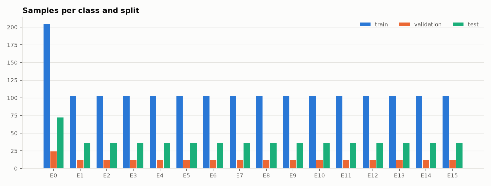

# FIR-Tamper dataset_v2 audit

Audit date: 18 October 2026. Dataset audited: `dataset_v2/` (PramaanDMS synthetic English dataset V2, version 0.2-pilot, generator seed 20261017). `labels.csv` SHA-256: `a45a5fde1287125804981f0ce58a2212b458e0048e4a4cd7b14f1d6aba846219`.

The audit only read the dataset. No dataset file was edited, moved or regenerated. All numbers below come from the scripts in this folder (`run_all.py`) and are saved in `stats.json` and `outputs/`.

## 1. Summary and verdict

**Verdict: No. The dataset is not ready to train the Legal Hash.**

dataset_v2 is structurally clean. All 3,407 files open, every label row has its file, no file lacks a label row, capture rows inherit their labels correctly, and no base document is split across train, validation and test. The teammate's own validators pass. The problems are in the content. Every page prints its own sample ID and class code (for example "Controlled synthetic variant: E6."), and OCR reads it from 94% to 97% of the images, so a model can read the answer off the page. All 50 base documents share one table layout and only 5 distinct narratives, which differ by place name only. Most tamper classes insert one fixed value everywhere (E1 always writes "Quinn Sampleton"), and that value appears in train, validation and test alike. Four of the 15 classes (E11, E12, E14, E15) do not do what their definition says on any of their 50 samples. The validation split holds only 4 base documents. There are no format-only Equivalent variants, so the false alarm rate on Equivalent copies (the metric `LEGAL_HASH_SPEC.md` calls most important) cannot be measured. A model trained and tested on this data would score well for the wrong reasons, and those scores could not go in the paper. The good news: every Blocker is a generator change, not hand work, and the generator is short. After the fixes in section 7, rerun this audit.

Issue count: **3 Blockers, 15 Majors, 9 Minors** (full list in section 7 and `issues.csv`).

## Spec: what the dataset is supposed to look like

Sources: `schemas/SCOPE.md`, `schemas/TAMPERING_DEFINITION.md`, `schemas/CRITICAL_FIELDS.md`, `README_DATASET.md`, the locked rules in `docs/TAMPERING_DEFINITION.md` and `DECISIONS.md` D39 to D49, `LEGAL_HASH_SPEC.md`.

| Item | Spec |
|---|---|
| Language | English only (D39) |
| Base documents | 50 first, up to 100 (SCOPE.md 5). Suggested mix 20 FIR, 15 charge sheet, 8 statement, 7 court order. Note: `BUILD_PLAN.md` Phase 4 exit says 1,000 originals and 5,000 pairs (open question 4) |
| Fields | 27 canonical fields per base record (CRITICAL_FIELDS.md) |
| Classes | E0 benign control; E1 name, E2 date, E3 time, E4 amount, E5 legal provision, E6 negation flip, E7 role reversal, E8 location, E9 evidence ID/description, E10 clause insertion, E11 clause deletion, E12 modal/quantifier shift, E13 custody chain, E14 backdating (printed date vs file metadata), E15 signature/seal region |
| Harmless vs material | Harmless (Equivalent): E0 only. Material (Materially Altered): E1 to E15. About one-third of samples should be harmless |
| Critical field rule | Harmless samples change no field value; each tampered sample has one primary class and changes only that class's fields |
| Label schema | `sample_id, doc_type, original_id, tamper_class, field_changed, page_affected, severity, expected_verdict, capture_type` (+ `split`). Severity Minor/Major/Format/None; verdict Tampered/Inconclusive/Valid; capture digital/scan/photo |
| Model target | 3-level verdict Identical / Equivalent / Materially Altered. Mapping used here: byte-identical copy = Identical; E0 and its captures = Equivalent; E1 to E15 in any capture = Materially Altered |
| Captures | digital PDF, simulated print-scan, simulated phone photo |
| Split | 70/15/15 by base document; every variant of a base in one split |

## 2. Inventory and schema (Steps 1 and 2)

| Item | Result |
|---|---|
| Files | 3,407: 850 PDF, 1,700 JPG, 852 JSON, 5 CSV |
| Size | 631.0 MB (JPG 625.8 MB, PDF 3.0 MB) |
| Label file | `labels.csv`, CSV with UTF-8 BOM, 11 columns, 2,550 rows |
| Other label files | `annotations/change_log.csv` (850), `annotations/capture_variants.csv` (1,700), `splits.csv` (50), `split_manifest.json`, `dataset_manifest.json` |
| Files on disk with no label row | 0 |
| Label rows with no file | 0 |
| Corrupt or unreadable files | 0 (every PDF, JPG, JSON and CSV opened) |
| PDF page counts | all 850 are 1 page; no empty text layers |
| Independent review file | missing (only `independent_review_template.csv`); all 850 change-log rows are `needs_review` |

Schema check over 2,550 rows: **4,100 violations of 2 kinds, both cosmetic.**

| Rule | Rows | Detail |
|---|---|---|
| `capture_type` not in {digital, scan, photo} | 1,700 | data uses `print_scan` and `phone_photo` |
| `page_affected` not an integer | 2,400 | value is `1 (verify rendered PDF)` |

Checks that passed with zero violations: required columns present and non-empty, no duplicate IDs, allowed values for doc_type, tamper_class, severity, verdict and split, one doc_type per base, **verdict matches class on every row** (no E0 row is Tampered, no E1 to E15 row is Valid), severity matches class, `field_changed` sits inside the class definition and equals the JSON diff, capture rows inherit their source labels, change log and splits.csv agree with labels.csv.

Missing from the schema: an explicit path to the original document (only `original_id`), and a verdict column in the model's 3-level vocabulary. The project's own validator (`ml/data/validate_labels.py`, D80) cannot read v2 at all: the BOM hides `sample_id` and the `files` column is missing (`outputs/project_validator_report.md`).

## 3. Coverage and balance (Step 3)

**Base documents by type** (target 50 to 100: met, at the floor)

| Type | Bases | % | SCOPE.md suggestion |
|---|---|---|---|
| FIR | 13 | 26.0 | 20 |
| charge_sheet | 13 | 26.0 | 15 |
| statement | 12 | 24.0 | 8 |
| court_order | 12 | 24.0 | 7 |
| **Total** | **50** | 100 | 50 |

**Tamper class** (all 2,550 rows; each class x document type cell = 13, 13, 12, 12 digital variants)

| Class | Rows | % | Class | Rows | % |
|---|---|---|---|---|---|
| E0 | 300 | 11.76 | E8 | 150 | 5.88 |
| E1 | 150 | 5.88 | E9 | 150 | 5.88 |
| E2 | 150 | 5.88 | E10 | 150 | 5.88 |
| E3 | 150 | 5.88 | E11 | 150 | 5.88 |
| E4 | 150 | 5.88 | E12 | 150 | 5.88 |
| E5 | 150 | 5.88 | E13 | 150 | 5.88 |
| E6 | 150 | 5.88 | E14 | 150 | 5.88 |
| E7 | 150 | 5.88 | E15 | 150 | 5.88 |

E0 has 300 rows because the 50 base PDFs are also labelled E0 (50 base + 50 E0 copies, x3 captures).

**Verdict, severity, capture**

| Expected verdict (as labelled) | Rows | % | 3-level target (mapped) | Rows |
|---|---|---|---|---|
| Valid | 300 | 11.76 | Identical | 0 |
| Tampered | 2,250 | 88.24 | Equivalent | 250 (+50 base anchors) |
| Inconclusive | 0 | 0 | Materially Altered | 2,250 |

| Severity | Rows | % |
|---|---|---|
| Major | 2,250 | 88.24 |
| None | 300 | 11.76 |
| Minor, Format | 0 | 0 |

| Capture | Rows | % |
|---|---|---|
| digital | 850 | 33.33 |
| scan (print_scan) | 850 | 33.33 |
| photo (phone_photo) | 850 | 33.33 |

Class x capture: every cell filled, 50 per cell (E0: 100). No empty cells.

Flags:
- Validation has only **12 samples per class** (4 bases x 3 captures; E0: 24). Too few to set thresholds or report per-class validation numbers.
- Harmless share is **11.76%** against the "about one-third" target. Tampered to Valid is 7.5 to 1.
- **No Minor, Format or Inconclusive labels** and **no Identical pairs** (no byte-identical copy of any original).
- Per-type counts differ from the SCOPE.md suggestion (more statements and court orders, fewer FIRs). Not a defect, but it should be a choice, not an accident.

Charts: `charts/base_docs_by_type.png`, `charts/class_distribution.png`, `charts/verdict_distribution.png`, `charts/capture_distribution.png`, `charts/class_x_capture.png`, `charts/class_x_doctype.png`, `charts/class_by_split.png`.

## 4. Split integrity (Step 4)

**Leakage by base document: none.** All 50 base documents sit in exactly one split, and splits.csv and split_manifest.json agree with labels.csv.

**Split ratio**

| Split | Bases | % | Samples | % | Target |
|---|---|---|---|---|---|
| train | 34 | 68.0 | 1,734 | 68.0 | 70 |
| validation | 4 | 8.0 | 204 | 8.0 | 15 |
| test | 12 | 24.0 | 612 | 24.0 | 15 |

Cause: `create_stratified_splits.py` uses `int(n * 0.15)` per type, which gives 1 validation base for 12 or 13 documents, and the rest falls to test.

Every class and every capture type appears in validation and test (all 48 class x capture cells present in both).

**Near-duplicate base documents across splits.** Similarity is RapidFuzz normalised Indel ratio on the ground-truth text, with the sample-ID header removed.

| Text compared | Min | Mean | Max | Cross-split pairs above 0.9 |
|---|---|---|---|---|
| Full printed page | 0.833 | 0.882 | 0.939 | **111 of 592** |
| Narrative fields only | 0.932 | 0.955 | 0.997 | **592 of 592** |
| 27 field values only | 0.732 | 0.812 | 0.906 | 2 of 592 |

Only **5 distinct narratives** exist across 50 bases (one per place name). Highest pairs: BASE-0006 (train) vs BASE-0009 (validation) 0.936; BASE-0005 (train) vs BASE-0029 (test) 0.935; BASE-0025 (train) vs BASE-0046 (validation) 0.933. All 111 pairs are in `outputs/step4_splits.json`.

So the split is leak-free by ID but not by content. For the narrative hash, every test narrative is a training narrative.

**Replacement values repeated across splits.** Distinct new values per class over 50 samples: E1 1, E2 1, E3 1, E4 1, E5 2 (act + section), E8 1, E9 1, E10 1, E11 1, E12 1, E13 1, E14 2 (two dates), E6 one edit ("was" -> "was not"), E7 15 (swaps of the name pool). In every case the same value or edit is in train, validation and test.

## 5. Tamper correctness (Step 5)

All 800 original/variant pairs were checked, not only 5 per class. For each pair: JSON diff, PDF text-layer diff, new value printed, change log agrees, and a class-specific semantic test. Five random pairs per class with full text diffs are in `outputs/step5_tamper.json` (`examples`).

| Class | Pass | Result | Example |
|---|---|---|---|
| E0 | 50/50 | PASS | BASE-0013-E0: fields identical; only the printed header differs |
| E1 | 50/50 | PASS | BASE-0033-E1: accused 'Finley Hart' -> 'Quinn Sampleton' |
| E2 | 50/50 | PASS | incident_date -> 2026-10-27 |
| E3 | 50/50 | PASS | BASE-0047-E3: 11:40 PM -> 11:40 AM |
| E4 | 42/50 | **PARTIAL** | 8 bases had 'Not applicable in this synthetic record', so the edit adds an amount: BASE-0004, 0012, 0018, 0021, 0028, 0033, 0037, 0038 |
| E5 | 50/50 | PASS | BASE-0015-E5: Sample Evidence Protection Act Section 24 -> Fictional Restricted Materials Act Section 99 |
| E6 | 50/50 | PASS | BASE-0033-E6: 'was removed' -> 'was not removed' (single negation token) |
| E7 | 50/50 | PASS | BASE-0044-E7: complainant and accused cleanly swapped |
| E8 | 50/50 | PASS (note) | incident_location -> 'Southport Fictional Yard'; jurisdiction and narrative still name the old place |
| E9 | 50/50 | PASS (note) | evidence_item_id -> 'EXHIBIT-SYN-Z999'; evidence_description still cites the old ID |
| E10 | 50/50 | PASS | BASE-0046-E10: inserted 'A second fictional witness stated that the parcel was missing.' |
| E11 | 0/50 | **FAIL** | BASE-0004-E11: the description is rewritten, not shortened. New words 'was', 'further', 'description', 'provided' are added |
| E12 | 0/50 | **FAIL** | BASE-0034-E12: a whole sentence is appended ('...must be treated as accounted for.'). That is clause insertion (E10), not a modal or quantifier swap |
| E13 | 50/50 | PASS | BASE-0033-E13: 'Fictional Evidence Unit 33' -> 'Fictional Evidence Unit 99' |
| E14 | 0/50 | **FAIL** | BASE-0048-E14: filing and document dates moved to 2025, but PDF CreationDate/ModDate are unchanged and the change log records no metadata. It is a two-date E2 edit |
| E15 | 0/50 | **FAIL** | BASE-0013-E15: the seal box text changes to 'ALTERED SYNTHETIC SEAL REGION - E15 TEST'. It is a text edit that spells out the class; no seal or signature image exists |

**Harmless variants:** no E0 sample changes any structured field or any printed content line. But all 50 E0 copies (and all 750 tampered variants) differ from their original in the printed header: `Sample ID: BASE-0013` -> `Sample ID: BASE-0013-E0` and `Original synthetic base record.` -> `Controlled synthetic variant: E0.` By the locked rule "any change to content is Tampered" this makes the harmless copies not strictly harmless, and it leaks the label (issue I01).

Other cross-checks: the new value is printed in the PDF for every changed field (0 misses); the change log matches the JSON diff for every pair (0 mismatches).

## 6. Content quality (Step 6)

**Realism.** Every document of every type is the same 27-row table with snake_case field names (`complainant_name`, `section_number`). There is one layout across all four types, so FIR, statement, charge sheet and court order differ only in the `document_type` value. Hits over the 50 bases for structural markers of Indian police documents:

| Marker | Bases with it |
|---|---|
| BNS / BNSS / BSA reference | 0 |
| u/s or "Section N of Act" citation | 0 |
| Police Station label | 0 |
| Complainant particulars (father's name, address) | 0 |
| Information received at PS / GD entry | 0 |
| Brief facts / statement heading | 0 |
| Officer rank or belt number | 0 |
| Signature line | 0 |
| "District" | 12 (only inside the invented place name "Northbridge Sample District", not a label) |

Acts are invented ("Synthetic Property Safety Act", "Fictional Public Order Act", "Sample Evidence Protection Act") with 4 section numbers (Section 12, 18, 24, 31). Names come from a pool of 15 non-Indian names (Avery Rowan, Morgan Ellis...). Base dates are internally consistent (0 timeline errors).

**Personal data.** No Indian mobile numbers, emails, Aadhaar-like or PAN-like numbers, PIN codes or street addresses found in any of the 850 text layers. All names are from the generator's invented pool. Nothing looks like a real person.

**Language.** English only. 0 PDFs contain Devanagari. The only non-ASCII character is the em dash in the page header (900 occurrences).

**Templating.** Distinct values across 50 bases: offence_description 5, act_name 3, section_number 4, incident_time 4, police_station 3, court_name 3, case_status 3, monetary_amount 5, names 14 to 15 per field. The sentence "The account is synthetic and created only to test meaning-aware document comparison." is in all 50 narratives; "A sealed sample parcel recorded as exhibit <ID>; no real evidence is represented." is in all 50.

**Image quality** (all 1,700 capture images; clean 160 dpi render for reference: sharpness 2,216, brightness 246, contrast 40)

| Metric | Scan (850) | Photo (850) |
|---|---|---|
| Resolution | 1323 x 1871 px, 160 dpi at A4 | same |
| Sharpness (Laplacian variance), min / median | 1,724 / 2,045 | 1,871 / 1,964 |
| Brightness, min / median (0 to 255) | 244 / 244 | 233 / 233 |
| Contrast (std), min / median | 36 / 39 | 40 / 40 |
| Absolute skew, median / max (degrees) | 0.2 / 1.1 | 2.1 / 3.1 |
| Flagged as too poor to OCR | 0 | 0 |

No image is too bad to OCR. The opposite is the problem: the captures are close to the clean render, with no low light, strong blur, folds, crops or JPEG damage.

**OCR check** (RapidOCR with PP-OCR ONNX models, default settings; 2 random images per class per capture, plus 1 digital render per class at 160 dpi; ground truth is the PDF text layer)

| Capture | n | CER mean | CER median | CER p90 | Token recall | Field exact-match | Tampered value read | Label readable in image |
|---|---|---|---|---|---|---|---|---|
| digital render | 16 | 0.041 | 0.043 | 0.062 | 0.932 | 0.963 | 0.867 | 0.938 |
| scan | 32 | 0.039 | 0.041 | 0.084 | 0.934 | 0.964 | 0.800 | 0.969 |
| photo | 32 | 0.155 | 0.115 | 0.355 | 0.929 | 0.950 | 0.733 | 0.938 |

How to read this: scan CER equals the digital render. Photo CER is higher, but token recall and field match are the same as digital, so most photo CER comes from line order under perspective (CER is order-sensitive), not misread characters. Missed fields are almost all the wrapped narrative fields (exact match fails across line breaks). The "tampered value read" rate is therefore a lower bound. The last column is the key finding: OCR reads the printed sample ID and class code from 94% to 97% of images. This is a small sample; treat these as rough numbers.

## 7. Issues

Full text with exact fixes is in `issues.csv`. Affected IDs for per-class issues list every failing sample.

| ID | Severity | Issue | Affected | Exact fix for the dataset owner |
|---|---|---|---|---|
| I01 | Blocker | Sample ID and class code printed on every page | all 850 PDFs, 1,700 images | In `generate_dataset_v2.py` `render_pdf()`, delete the "Sample ID" paragraph and the note paragraph; set PDF Title to a neutral value. Base, E0 and every variant must print the same header. Regenerate PDFs and captures |
| I02 | Blocker | Narratives are one template (5 distinct); train and test share the text | all 50 bases | Unique narrative per base (80 to 250 words, several sentences, with dates, times, names, amounts and vehicle numbers inside). At least 10 incident templates plus paraphrase, disjoint between train and val/test. Recheck cross-split narrative similarity stays below 0.9 |
| I03 | Blocker | Each class inserts the same value everywhere | E1 to E5, E8 to E14 | Draw replacements from pools (near-miss dates, one-digit amount edits, one-character ID edits). Disjoint pools for train vs val/test. Rotate E1 over all six name fields and E2 over all five date fields |
| I04 | Major | E11 is a rewrite, not a deletion | all 50 E11 | Delete one sentence or clause from a multi-sentence narrative; keep every other token |
| I05 | Major | E12 appends a sentence (same as E10) | all 50 E12 | Swap one modal or quantifier in place (may -> shall, some -> all) with no other change |
| I06 | Major | E14 has no metadata inconsistency | all 50 E14 | Set CreationDate/ModDate later than the backdated printed date and log both, or merge E14 into E2 (open question 7) |
| I07 | Major | E15 is a text change that names the class | all 50 E15 | Draw a synthetic seal or signature image and alter it visually; keep printed text identical; never print the class code |
| I08 | Major | Validation split has 4 bases (8%) | splits.csv | Use `round()` for the 15% share in `allocate_type()` (gives 35/8/7), after the content fixes; freeze and record split SHA-256 |
| I09 | Major | No format-only Equivalent variants, no Identical pairs | E0 | Add E0 sub-types (exact copy, reflow, font, spacing, date and number format, honorific, section order, vehicle separators) with an `e0_subtype` column |
| I10 | Major | Harmless share 11.76% vs about 33% | labels.csv | Add the I09 sub-types until harmless is about one-third, or report class-weighted metrics |
| I11 | Major | No page, stamp, annotation or Minor-edit cases (D40 to D46) | whole dataset | Add classes for page add/remove/reorder (multi-page docs), word swap or rewording, annotations, name order; or record in DECISIONS.md that these come from the v0 generator |
| I12 | Major | Verdict vocabulary differs from the model and the project schema; project validator cannot read v2 | labels.csv | Add `verdict_3level` and `original_path` columns; write UTF-8 without BOM; agree one schema with `ml/data/validate_labels.py` |
| I13 | Major | Teammate's E0 allows synonym substitution as Valid (conflicts with D6/D49) | schemas/TAMPERING_DEFINITION.md | Remove synonym swaps from E0; they are wording changes |
| I14 | Major | Documents do not look like Indian police or court documents | all 50 bases | One layout per type (FIR in BNSS form order, statement as first-person prose, charge sheet with accused and witness lists, court order with operative part); invented Indian names; D34 conventions; BNS sections marked as example values |
| I15 | Major | Simulated captures are almost as clean as the digital PDF | captures/ | Add a `capture_level` (mild/moderate/hard): JPEG 40 to 70, blur 0.5 to 1.5 px, rotation up to 5 degrees, low light, shadow, fold, crop; a small hard set labelled Inconclusive |
| I16 | Major | Independent 10% review not done | change_log.csv | After the fixes, a second person reviews 255 stratified rows into `annotations/independent_review.csv` |
| I17 | Major | Capture script imports PyMuPDF (AGPL-3.0), against D61 | scripts/make_capture_variants.py | Render with pypdfium2: `pdfium.PdfDocument(p)[0].render(scale=160/72).to_pil()` |
| I18 | Major | court_order is out of project scope (D32), but 12 of 50 bases (24%) are court orders | all court_order bases | Decide with the owner (open question 11). If D32 stands, replace court orders with statements and charge sheets; otherwise record a decision that replaces D32 |
| I19 | Minor | E4 adds an amount where none existed | BASE-0004/0012/0018/0021/0028/0033/0037/0038-E4 | Apply E4 only to bases with an amount, or label as "value added" |
| I20 | Minor | capture_type spelling differs from SCOPE.md | 1,700 rows | One spelling in both places (open question 8) |
| I21 | Minor | page_affected is free text | 2,400 rows | Integer page number |
| I22 | Minor | No explicit original path | labels.csv | Add `original_path` and `original_sha256` |
| I23 | Minor | E8 and E9 leave an easy cross-field mismatch | all E8, E9 | Decide (open question 6); report a consistency-rule baseline either way |
| I24 | Minor | Base PDF and E0 copy both labelled E0 | 50 base rows + captures | Mark base rows as `role=original`; exclude from class counts |
| I25 | Minor | dataset_manifest.json is stale | dataset_manifest.json | Regenerate with captures, splits and per-split hashes |
| I26 | Minor | Page header uses an em dash | all PDFs | Plain hyphen or colon |
| I27 | Minor | Two datasets exist; docs/DATASET.md covers only v0; v2 has no split hashes; not git-ignored | docs | Decide the canonical dataset (open question 1); add a v2 card with hashes; git-ignore generated folders |

## 8. Open questions (with recommended answers)

1. **Which dataset is canonical, `dataset/` (v0, built by `ml/data/generator`) or `dataset_v2/`?** Recommended: one dataset only. The project generator already follows the locked rules (D77, D78), has equivalence traps, real-looking layouts and tests. Map its classes onto the E0 to E15 names, rather than rebuild those features in the v2 script. The dataset owner decides.
2. **Which verdict names go in the labels?** Recommended: keep the locked D49 names (Identical, Equivalent, Tampered, Inconclusive) in the data, and use "Materially Altered" only as the paper's name for Tampered. Add a `verdict_3level` column for the model.
3. **Are all of E1 to E15 "Materially Altered"?** Recommended: yes for the 3-level verdict. Keep severity separate and set it by the locked rules: E10 and E12 sentences with no narrative entity are Minor; everything else here is Major.
4. **Size target: 50 to 100 bases (SCOPE.md) or 1,000 originals and 5,000 pairs (`BUILD_PLAN.md` Phase 4)?** Recommended: 50 to 100 is fine for a pilot. For training N with triplet loss and a credible test set, aim for at least 200 bases with unique narratives, and update `BUILD_PLAN.md` to the agreed number.
5. **Should the base PDF count as an E0 sample?** Recommended: no. It is the anchor. Give it its own role, and make the E0 copy a true format variant (or a byte-identical copy for Identical).
6. **E8/E9: change one field only, or keep the document consistent?** Recommended: keep single-field edits (a real forger may miss the second mention), but report a simple consistency-rule baseline so the paper shows what the hash adds.
7. **Should E14 depend on file metadata?** Recommended: no, for the Legal Hash dataset. Verify reads page content, and a photo has no PDF metadata. Make E14 a printed-date backdating pattern (for example a BNS citation on a date before 1 July 2024, for Phase 25) and keep metadata tests for the forensic report only.
8. **Capture spelling?** Recommended: `scan_sim` and `photo_sim` (D33). The names then say the captures are simulated, and `scan_real`/`photo_real` stay free for Phase 10.
9. **Can simulated captures support paper claims?** Recommended: report them separately as "simulated capture" results. Real-world capture claims wait for the Phase 10 print-and-photo set.
10. **E0 synonym substitution.** Recommended: follow the locked rule D6/D49. A reworded sentence is Tampered (Minor), never E0.
11. **Are court orders in scope?** The project scope (`docs/SCOPE.md`, D32) says no; the teammate's `schemas/SCOPE.md` says yes. Recommended: follow D32 for v1 (three types are enough to prove the method) and move the 12 court-order slots to statements and charge sheets. Court orders can come back as future work.

## 9. Numbers for the paper's dataset section

These describe dataset_v2 as it is today. **Do not publish them as the final dataset.** After the Blockers are fixed, rerun `run_all.py` and take the numbers from the new `stats.json`.

| Item | Value |
|---|---|
| Base documents | 50 (FIR 13, charge sheet 13, statement 12, court order 12) |
| Fields per base | 27 |
| Classes | 16 (E0 control + 15 tamper classes) |
| Digital samples | 850 (50 originals + 50 E0 copies + 750 tampered, 50 per class) |
| Capture variants | 850 simulated print-scan + 850 simulated phone-photo |
| Total labelled samples | 2,550 |
| Harmless / material | 300 (11.76%) / 2,250 (88.24%) |
| Split by base document | train 34 / val 4 / test 12 (68 / 8 / 24%) |
| Samples per split | 1,734 / 204 / 612 |
| Per class per split | train 102, val 12, test 36 (E0: 204, 24, 72) |
| Language | English only |
| Image resolution | 1323 x 1871 px (160 dpi at A4) |
| OCR CER (RapidOCR, sample) | digital 0.041, scan 0.039, photo 0.155 |
| OCR field exact-match (sample) | digital 0.963, scan 0.964, photo 0.950 |
| Generator seed | 20261017 |
| labels.csv SHA-256 | a45a5fde1287125804981f0ce58a2212b458e0048e4a4cd7b14f1d6aba846219 |

## 10. How this audit was run

Python 3.14.7, packages pinned in `requirements-audit.txt`. Rerun steps are in `README.md`. The teammate's validators were also run read-only (`outputs/teammate_validators_output.txt`): both PASS, 1 warning (E0 count). Their checks are structural. The issues above are in content they do not check.
